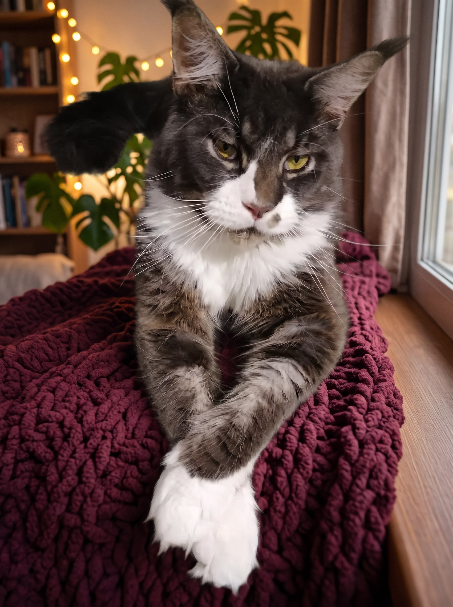
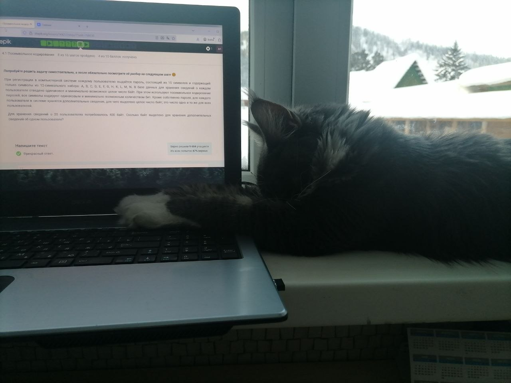

# 🐾 Лапки в коде: Учебный репозиторий СибГУТИ

> **Йоу-привет!** Добро пожаловать в хранилище моего кода, бессонных ночей, дедлайнов и побеждённых багов.  
> *Если код работает — не трогай его. Если не работает — погладь кота Антошку* ⬇🐈‍⬛💻 

|  |
| :---: |

### 🚀 Что лежит внутри?
* **Лабораторные работы** по программированию.
* **Эксперименты с Git**, где ветки иногда ссорятся, но всегда мирятся.
* **Костыли и велосипеды**, собранные с любовью и сданные в срок.

### 🛠️ Мой стек выживания
* **Языки:** Python, C (и слёзы компилятора).
* **Среда:** VS Code и терминал, который не понимает меня с полуслова.
* **Главный инструмент отладки:** метод утёнка и кружка горячего чая.

---

🐾 Нажми, чтобы погладить кота Антошку и открыть досье

* **Должность:** Главный тестировщик клавиатуры и моральная поддержка.
* **Суперсила:** Умеет лечь на клавишу `Enter` ровно в момент сдачи лабы.
* **Статус:** Одобряет этот код на 10 из 10.
  

